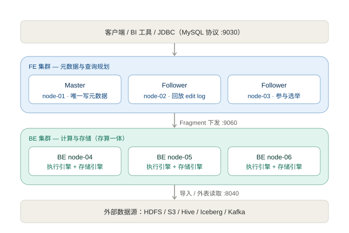
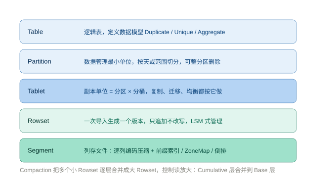
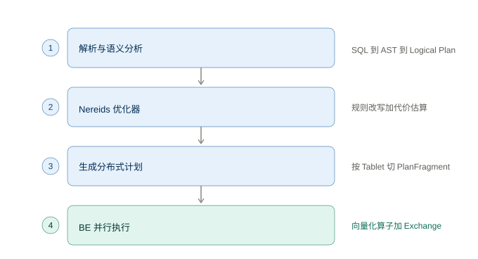

# Apache Doris 体系架构

> 适用版本：2.1 / 3.x / 4.x（存算分离差异在 §6 单独说明）
> 对应部署：`ai4doris` 6 节点集群（3 FE + 3 BE，存算一体）

---

## 目录

- [0. 一句话定位](#0-一句话定位)
- [1. 分层架构](#1-分层架构)
- [2. FE：集群的大脑](#2-fe集群的大脑)
- [3. BE：真正干活的部分](#3-be真正干活的部分)
- [4. 数据是怎么组织的](#4-数据是怎么组织的)
- [5. 一条 SQL 的旅程](#5-一条-sql-的旅程)
- [6. 写入路径与两阶段提交](#6-写入路径与两阶段提交)
- [7. 存算一体 vs 存算分离](#7-存算一体-vs-存算分离)
- [8. 在技术栈中的位置](#8-在技术栈中的位置)
- [9. 端口与进程映射](#9-端口与进程映射)
- [10. 常见误区清单](#10-常见误区清单)

---

## 0. 一句话定位

Doris 是典型的 **MPP 架构分析型数据库**：**FE 只负责「想」，BE 负责「算和存」**，两者之间靠元数据和 Fragment 执行计划连接。

它把 ClickHouse 的单机极致性能与 MPP 的横向扩展能力结合起来，同时对 MySQL 协议兼容——这是它能在实时数仓里整体替代 ClickHouse + Presto 组合的根本原因。

三个核心设计取向：

| 取向 | 具体做法 | 带来的结果 |
|---|---|---|
| 极简架构 | 只有 FE、BE 两类进程，无外部依赖 | 部署简单，6 台机器就能跑生产 |
| 列存 + 向量化 | Segment 列式存储，按 4096 行批量计算 | 单机扫描性能接近 ClickHouse |
| MPP 并行 | 按 Tablet 切分执行实例，Exchange 汇总 | 加机器就能横向扩展 |

---

## 1. 分层架构



图 1：自上而下为客户端、FE 集群、BE 集群、外部数据源四层。

| 层 | 组件 | 职责 |
|---|---|---|
| 接入层 | MySQL 客户端 / JDBC / BI 工具 | 走 9030 端口，用标准 MySQL 协议 |
| 元数据与规划层 | FE（Java 进程） | 元数据管理、SQL 解析优化、集群调度 |
| 计算与存储层 | BE（C++ 进程） | 数据存储、副本管理、向量化执行 |
| 外部数据层 | HDFS / S3 / Hive / Iceberg / Kafka | 通过 Catalog 或 Broker 访问，也可直接导入 |

**关键点**：FE 不存业务数据，BE 不存元数据。这个边界非常干净，是排查问题的第一依据——查不到表是 FE 的问题，查得慢是 BE 的问题。

---

## 2. FE：集群的大脑

FE（Frontend）负责三件事：**接收 SQL、管理元数据、生成分布式执行计划**。它自己不碰数据。

### 2.1 三种角色

| 角色 | 数量 | 职责 | 能写元数据 |
|---|---|---|---|
| **Master** | 1 个（自动选举） | 执行所有元数据变更：DDL、建表、节点上下线、副本调度 | 是 |
| **Follower** | ≥2 个，必须奇数 | 回放 edit log、参与选举、承接读请求 | 被选为 Master 才行 |
| **Observer** | 任意 | 只同步元数据、对外提供查询服务，**不参与选举** | 否 |

三个 FE 全是 Follower 是标准做法，Master 由 Paxos 类协议选举产生。加 Observer 不影响法定人数，是横向扩查询并发的安全选择。

> 法定人数规则：3 个 FE 容忍 1 台故障，5 个容忍 2 台。**2 个 FE 是危险配置**——挂一台就失去仲裁，集群只读甚至不可用。

### 2.2 元数据是怎么存的

```
SQL DDL / 节点变更
      │ 串行化
      ▼
   edit log（BDBJE，类 Paxos 复制到所有 Follower）
      │ 回放
      ▼
   内存镜像（Memory Meta，所有查询读这里，所以元数据查询极快）
      │ 定期 Checkpoint
      ▼
   image 文件落盘（fe/meta/image/）
```

它把元数据变更当成**日志**复制，而不是复制整份元数据。

- 为什么快：所有元数据查询都命中内存，不走磁盘。
- 为什么怕丢：`meta_dir` 丢了就要重建集群，**必须单独备份**。
- 为什么重启快：先加载最新 image，再回放其后的 edit log，不用全量重放。

### 2.3 FE 内部模块

| 模块 | 作用 |
|---|---|
| SQL Parser | 词法 / 语法解析，生成 AST |
| Analyzer | 表、列、函数、权限校验，生成逻辑计划 |
| **Nereids 优化器** | 规则改写 + 基于代价的优化（CBO），决定 Join 顺序与分布方式 |
| Planner | 把物理计划切成 `PlanFragment`，分配到 BE |
| Metadata Manager | 内存元数据镜像 + edit log 回放 + checkpoint |
| Cluster Manager | 节点心跳、副本调度、tablet 均衡、副本修复 |
| Load Manager | 导入事务管理（version 分配与 publish） |

---

## 3. BE：真正干活的部分

BE（Backend）是 C++ 进程，**计算和存储都在这里**，是集群唯一需要大内存和大磁盘的角色。

| 子系统 | 干什么 | 关键技术 |
|---|---|---|
| **存储引擎** | 列存、多版本、副本管理 | LSM-tree、Rowset、Segment、前缀索引 |
| **执行引擎** | 执行 Fragment | 向量化、Pipeline 并行、算子下推 |
| **副本管理** | 3 副本 quorum 写、副本修复、均衡 | FE 调度，BE 执行 |

### 3.1 三个必须记住的机制

1. **向量化执行**：按批（默认 4096 行）处理而非按行，配合 SIMD 指令。所以 **CPU 必须支持 AVX2**——这是虚拟机要设 `host-passthrough` 的原因，否则性能断崖式下跌。
2. **Pipeline 执行模型**：把算子拆成流水线，避免阻塞等待，自动按 CPU 核数调并行度。
3. **算子下推**：谓词、聚合、TopN、Join 尽量推到 BE 本地执行，只回传结果，减少 shuffle 数据量。

### 3.2 写入即追加（LSM 思路）

BE 不做原地更新：每次导入生成新的 Rowset，旧版本通过版本号管理，后台由 Compaction 合并。这带来两个直接后果：

- 写入吞吐高、无随机写放大；
- **必须控制导入频率**，小批次高频导入会产生大量小文件，Compaction 追不上就出现 `-235` 版本过多错误。

---

## 4. 数据是怎么组织的



图 2：Table → Partition → Tablet → Rowset → Segment 五层结构。

| 层级 | 定位 | 决定什么 |
|---|---|---|
| **Table** | 逻辑表 | 数据模型：Duplicate / Unique / Aggregate |
| **Partition** | 数据管理最小单位 | 数据生命周期（保留、删除、冷热） |
| **Tablet** | 副本与并行度的最小单位 | `分区数 × 分桶数` 决定并行度 |
| **Rowset** | 一次导入的版本 | 版本管理、Compaction 的合并对象 |
| **Segment** | 列存文件 | 编码压缩、索引、扫描裁剪 |

### 4.1 三种数据模型

| 模型 | 语义 | 典型场景 |
|---|---|---|
| **Duplicate** | 只追加，不去重 | 明细日志、埋点、逐笔记录 |
| **Unique** | 主键唯一，后写覆盖（Merge-on-Write） | 维表、需要更新的汇总表 |
| **Aggregate** | 同 key 按聚合函数合并（sum/max/replace） | 预聚合指标表 |

### 4.2 分桶原则

| 规则 | 说明 |
|---|---|
| 桶数取 **BE 数量的整数倍** | 3 个 BE 就用 3 / 6 / 9，用 4 或 5 必然倾斜 |
| 单 Tablet 数据量 **1~10GB** | 太小则元数据爆炸（FE 内存吃紧），太大则并行度不足 |
| 分桶键选高基数字段 | 用产线/料号，别用性别、状态这类低基数列 |
| 单表 Tablet 总数控制 | 16G 内存的 BE 建议 `分区数 × 桶数 ≤ 5000` |

### 4.3 Segment 里的索引

| 索引 | 作用 | 什么时候生效 |
|---|---|---|
| **前缀索引** | 排序键前 36 字节的稀疏索引，定位数据块 | 范围查询、前缀匹配 |
| **ZoneMap** | 每列 min/max，跳过整个数据块 | 范围过滤、`!=` |
| **BloomFilter** | 判断值是否存在，避免读块 | 高基数列等值查询 |
| **倒排索引** | 文本分词、枚举精确匹配 | 日志检索、标签过滤 |

---

## 5. 一条 SQL 的旅程



图 3：四个阶段，前三步在 FE，最后一步在 BE。

| 阶段 | 位置 | 具体做什么 |
|---|---|---|
| ① 解析与语义分析 | FE | 词法/语法解析成 AST，转逻辑计划，做表、列、权限校验 |
| ② Nereids 优化 | FE | 规则改写（谓词下推、常量折叠、子查询解关联、分区裁剪）+ 基于统计信息估算代价，选 Join 顺序与分布方式 |
| ③ 生成分布式计划 | FE | 按 Tablet 切成 `PlanFragment`，每个 Fragment 对应一个 BE 执行实例 |
| ④ 并行执行 | BE | 向量化算子执行，跨 BE 用 **Exchange**（广播 / 分区 shuffle / 单点汇总）搬运数据，汇总节点返回结果 |

### 5.1 并行度从哪来

```
并行度 = min(分区数 × 分桶数, 各 BE parallel_pipeline_task_num 之和)
```

分桶太少，机器再多也并行不起来——这是「分桶数必须 ≥ BE 数量」的真正原因。

### 5.2 优化器看什么

Nereids 依赖**统计信息**做代价估算。表刚建、没收集统计信息时，容易选错 Join 顺序，表现为「小表 join 大表反而慢」。此时执行：

```sql
ANALYZE TABLE db.tbl WITH SYNC;
```

---

## 6. 写入路径与两阶段提交

Doris 的导入是**先写不可见版本，再统一发布**，这是保证多副本原子性的核心设计。

```
① Load：数据写进 BE，生成 Rowset，version = -1（客户端不可见）
        │ 3 副本全部写完（quorum）
        ▼
② Publish Version：FE 分配正式版本号 → BE 使 3 副本同时可见
```

任一副本写失败就整体回滚，不会出现「半条数据可见」。因此导入是**事务性**的，同一批数据重复导入不会脏读。

| 导入方式 | 适用场景 | 特点 |
|---|---|---|
| **Stream Load** | 单次小批量、程序调用 | HTTP 同步返回，最灵活 |
| **Broker Load** | 大批量、从 HDFS/S3 | 异步任务，适合 T+1 |
| **Routine Load** | Kafka 持续消费 | 常驻作业，自动断点续传 |
| **Insert Into** | SQL 方式加工 | 适合表间 ETL |

> 常见故障：`-235` 表示版本数过多，本质是导入太碎。处理方式是攒批（单批 ≥ 100MB 或 ≥ 10 秒）并调大 Compaction 并发，而不是简单重启。

---

## 7. 存算一体 vs 存算分离

存算分离从 3.0 版本开始支持。

| 维度 | 存算一体 | 存算分离 |
|---|---|---|
| 存储 | BE 本地盘，3 副本 | 共享对象存储（S3/HDFS），单副本或 EC |
| 元数据 | FE 的 BDBJE | 独立 **Meta Service** + FoundationDB |
| 计算节点 | 有状态 BE | 无状态 Compute Node + 本地 Cache |
| 扩容 | 加 BE 要搬数据 | 加计算节点秒级完成，不搬数据 |
| 成本 | 3 副本 × 本地盘 | 存储成本可降到约 1/10 |
| 冷读延迟 | 无额外开销 | 未命中 Cache 时上升 10%~35% |
| 负载隔离 | 弱 | 多计算集群共享一份数据，读写物理隔离 |

**选型判断**：

- 数据量 < 100TB、追求低延迟 → **存算一体**
- 数据量 PB 级、需要弹性或多业务隔离 → **存算分离**
- 6 台机器 400G/节点的规模 → 走一体，分离要多一套 FoundationDB，资源放不下

---

## 8. 在技术栈中的位置

| 层 | 组件 | 与 Doris 的关系 |
|---|---|---|
| 采集 | Kafka | Routine Load 直接消费，形成实时链路 |
| 计算 | Flink / Spark | 加工后写入 Doris，或 Doris 只做结果层 |
| 存储 | HDFS / Iceberg / Hive | Doris 通过 Catalog 联邦查询，不落库也能查 |
| **查询** | **Doris** | 统一 SQL 入口，BI / 看板 / 即席查询都打这里 |
| 调度 | Airflow / DolphinScheduler | 调度 ETL 与物化视图刷新 |

对制造场景（CHOT）：Doris 承担**良率日报、产线看板、即席分析**的查询层——Spark 做宽表加工，Doris 存聚合结果与明细，BI 直连 9030 端口。

---

## 9. 端口与进程映射

| 端口 | 进程 | 架构上的作用 |
|---|---|---|
| 9030 | FE | MySQL 协议入口，客户端只认这个 |
| 8030 | FE | Web UI + Stream Load 入口 |
| 9010 | FE | edit log 复制，**FE 之间同步元数据的通道** |
| 9020 | FE | FE 内部 RPC |
| 9050 | BE | 心跳，BE 挂了 FE 靠它感知 |
| 9060 | BE | FE 下发 Fragment、BE 上报状态 |
| 8040 | BE | Stream Load 直写、metrics 暴露 |
| 8060 | BE | brpc，BE 之间的数据交换走这里 |

排查顺序对应关系：

| 现象 | 先看 |
|---|---|
| 连不上数据库 | 9030 是否监听、FE 是否 Alive |
| FE 之间不同步 | 9010 是否通、edit log 是否堆积 |
| BE 显示 dead | 9050 心跳、BE 进程是否在 |
| 查询报分发失败 | 9060 是否通 |
| 导入失败 | 8040 是否可达、BE 磁盘水位 |

---

## 10. 常见误区清单

| 误区 | 实际情况 |
|---|---|
| 「FE 越多越好」 | FE 数量必须是奇数，且不宜过多（5 个以上收益递减）；扩查询并发应该加 Observer 或 BE |
| 「2 个 FE 也能高可用」 | 挂一台就失去仲裁，必须 ≥3 且奇数 |
| 「分桶越多越快」 | 分桶过多导致小文件、元数据膨胀、Compaction 压力大，单 Tablet 1~10GB 为宜 |
| 「BE 可以随便加 CPU 超分」 | BE 依赖真实内存做 mem_limit，超分会 OOM Kill |
| 「元数据在本地盘不怕丢」 | `meta_dir` 必须定期备份，丢了只能重建集群 |
| 「存算分离一定更省钱」 | 小规模下多一套 FoundationDB + 对象存储，运维成本反而上升 |
| 「Doris 能当 OLTP 用」 | 高并发点查性能有限，单表 QPS 远不及 MySQL，它定位是 OLAP |
| 「导入越频繁越实时」 | 小批次高频写入会触发 `-235`，必须攒批 |

---

## 附：与 6 节点部署的对应关系

| 主机 | IP | 角色 | 承载的架构职责 |
|---|---|---|---|
| doris-node-01 | 192.168.1.51 | FE Master | 元数据写入、查询规划、集群调度 |
| doris-node-02 | 192.168.1.52 | FE Follower | 元数据副本、参与选举、分担查询 |
| doris-node-03 | 192.168.1.53 | FE Follower | 元数据副本、参与选举、分担查询 |
| doris-node-04 | 192.168.1.54 | BE | 数据存储 + 向量化执行 |
| doris-node-05 | 192.168.1.55 | BE | 数据存储 + 向量化执行 |
| doris-node-06 | 192.168.1.56 | BE | 数据存储 + 向量化执行 |

副本分布：每个 Tablet 的 3 个副本分别落在 node-04/05/06，任一 BE 故障数据仍可读。
FE 法定人数：3 个 Follower 容忍 1 台故障。

---

*文档对应仓库 `ai4doris`，部署脚本见 `scripts/`，参数说明见 `README.md`。*
